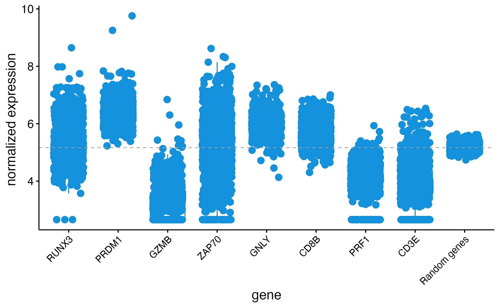
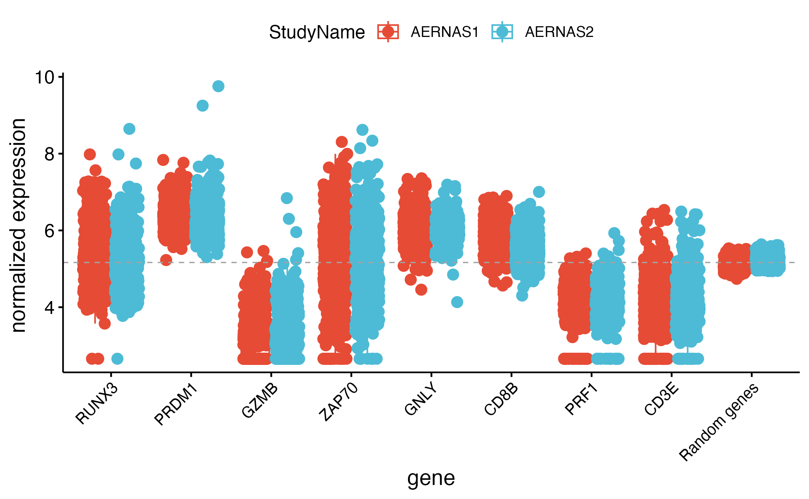
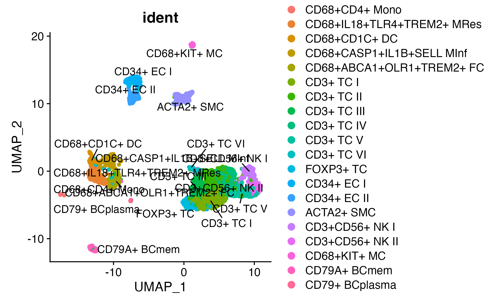
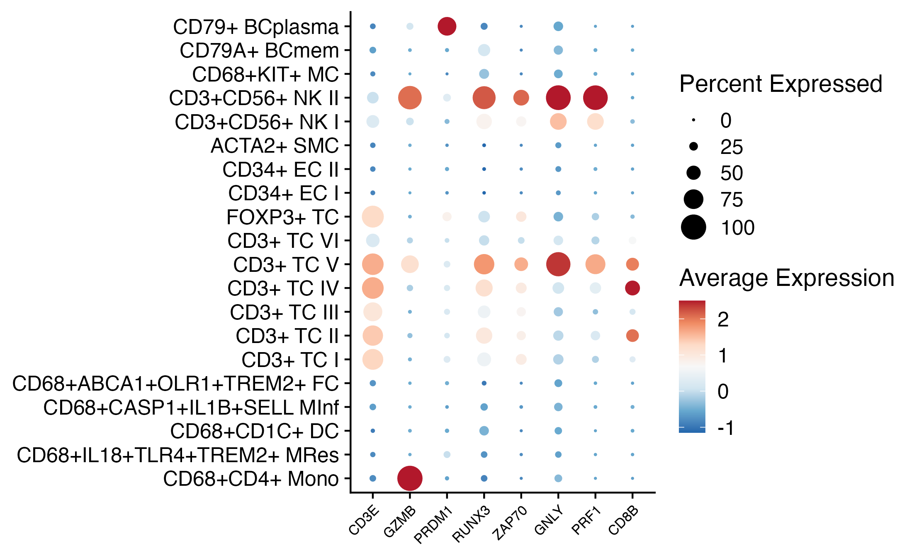
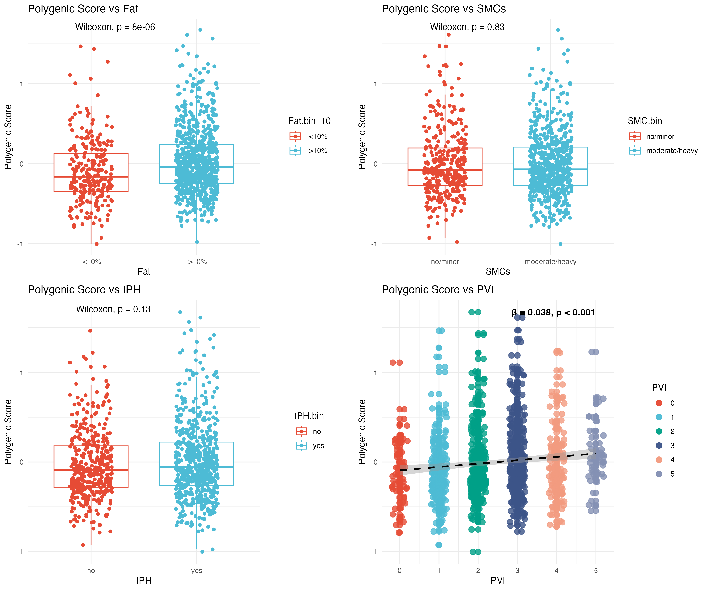
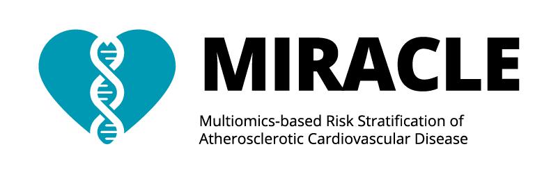
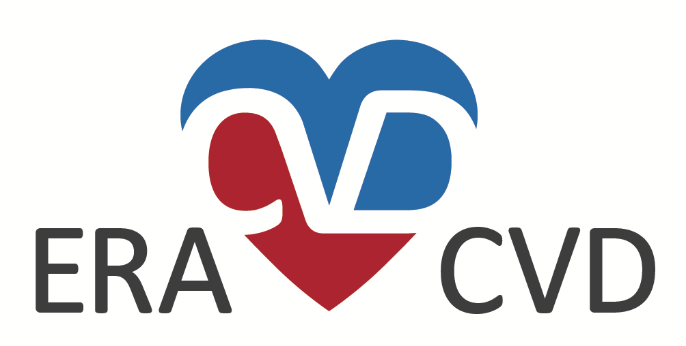
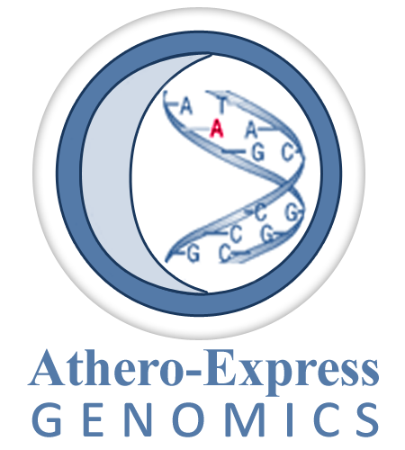

<!--  Provide a title.         -->
[AE_20241004_JNoonan_PMaffia_TCells](https://github.com/CirculatoryHealth/AE_20241004_JNoonan_PMaffia_TCells)
============

<!--  Provide details on the people involved in the project.         -->
*Collaborators*

Jonathan Noonan, 
Pasquale Maffia, 

*Athero-Express Team*

Sander W. van der Laan, 
Michal Mokry, 
Ernest Diez Benavente, 
Hester den Ruijter, 
Dominique de Kleijn,
Gert Jan de Borst, 
Gerard Pasterkamp.

<!--  Provide the project ID.         -->
**Project ID** [`AE_20241004_JNoonan_PMaffia_TCells`]

# Background
<!--  Provide some background, study design, results, etc.         -->
Collaboration to study the association of gene expression of T-cell related genes with atherosclerotic plaques characteristics. 

## Study design

We will test the hypothesis the gene expression these genes-of-interest is associated with plaque characteristics. We will use data from the **Athero-Express Biobank Study**.

These are the questions we will address: 

- Is the _gene expression_ correlated to characteristics of plaques?
- In which _cell types_ are the target genes expressed? 

## Athero-Express Biobank Study

We have bulk RNAseq (n ± 1,100 samples) and single-cell RNAseq data (n ± 46) with extensive histological plaque characterisation. 

The primary plaque phenotypes are:

- `fat10`, coded `Fat.bin_10` no/<10% fat vs. >10% fat
- `fat40`, coded `Fat.bin_40` no/<40% fat vs. >40% fat
- `intraplaque hemorrhage`, coded `IPH.bin` no vs. yes
- `smooth muscle cells (alpha-actin)`, coded `smcmean0` mean of computer-assisted calculation SMA+ region of interest
- `smooth muscle cells (alpha-actin)`, coded as no/minor vs. moderate/heavy staining
- `plaque vulnerability index`, scaled from 0 to 4, where 0 is most stable, and 4 is least stable plaque phenotype.

The secondary plaque phenotypes are:

- `calcification`, coded `Calc.bin` no/minor vs. moderate/heavy staining
- `collagen`, coded `Collagen.bin` no/minor vs. moderate/heavy staining
- `macrophages (CD68)`, coded `macmean0` mean of computer-assisted calculation CD68+ region of interest
- `macrophages (CD68)`, coded as no/minor vs. moderate/heavy staining
- `intraplaque vessel density (CD34)`, coded `vessel_density` manually counted CD34+ cells per 3-4 hotspots
- `mast cells`, coded `Mast_cells_plaque` manually counted mast cell tryptase+ cells (https://academic.oup.com/eurheartj/article/34/48/3699/484981) [Note: low sample size]
- `neutrophils (CD66b)`, coded `neutrophils` manually counted CD66b+ cells (https://pubmed.ncbi.nlm.nih.gov/20595650/) [Note: low sample size]

Continuous variables were inverse-rank normal transformated, indicated by `_rankNorm`. 

### Whole-plaque RNAseq

For the expression analysis we used carotid plaque-derived bulk RNAseq data and queried it for the gene list. Below a graph showing the overall expression of the genes (not all are in the data) compared to the mean expression of 1,000 randomly picked genes. 

**Figure 1A: Overall expression of target genes in carotid plaques from the Athero-Express Biobank Study**

**Figure 1B: Overall expression of target genes by experiment in carotid plaques from the Athero-Express Biobank Study**

### Single cell RNAseq

We projected target genes to the single-cell RNAseq data derived from 46 carotid plaque samples. We identified cell communities (Figure 2), mapped and projected target gene expression to the cell communities (Figure 3). 

**Figure 2: Cell communities identified in carotid plaques from the Athero-Express Biobank Study**

**Figure 3: Dotplot showing expression of target genes per cell type in carotid plaques from the Athero-Express Biobank Study**

### Polygenic score

We also created a polygenic score for the target genes using a function that takes into account the variance of all genes in the bulk RNAseq data.

**Figure 4: Polygenic score for target genes in carotid plaques from the Athero-Express Biobank Study**

# Where do I start?

You can load this project in RStudio by opening the file called 'AE_20241004_JNoonan_PMaffia_TCells.Rproj'.

## Project structure

<!--  You can add rows to this table, using "|" to separate columns.         -->
File                                    | Description                          | Usage         
--------------------------------------- | ------------------------------------ | --------------
README.md                               | Description of project               | Human editable
AE_20241004_JNoonan_PMaffia_TCells.Rproj                       | Project file                         | Loads project
LICENSE                                 | User permissions                     | Read only
.worcs                                  | WORCS metadata YAML                  | Read only
renv.lock                               | Reproducible R environment           | Read only
images                                  | image directory for project          | Human editable
BASELINE                                | Baseline characteristics directory   | Human editable
OUTPUT                                  | Output directory                     | Human editable
PLOTS                                   | Some results                         | Human editable
SNP                                     | SNP analysis directory               | Human editable
scripts                                 | Scripts directory                    | Human editable
targets                                 | Directory containing list of targets | Human editable
packages.bib                            | BibTex references for packages used  | Human editable
references.bib                          | BibTex references                    | Human editable
1_AEDB.CEA.baseline.Rmd                | Preparing data, baseline table       | Human editable
3_1_bulkRNAseq.preparation.Rmd          | Preparing bulk RNAseq analyses       | Human editable
3_2_bulkRNAseq.exploration.Rmd          | Exploration RNAseq.                  | Human editable
3_3_bulkRNAseq.main_analysis.Rmd        | Main RNAseq analyses                 | Human editable
3_4_bulkRNAseq.additional_figures.Rmd   | Additional RNAseq figures            | Human editable
4_scRNAseq.Rmd                          | Single-cell RNAseq analyses          | Human editable

<!--  You can consider adding the following to this file:                    -->
<!--  * A citation reference for your project                                -->
<!--  * Contact information for questions/comments                           -->
<!--  * How people can offer to contribute to the project                    -->
<!--  * A contributor code of conduct, https://www.contributor-covenant.org/ -->

## Create a target list

The list of genes-of-interest are in `targets.xlsx`. 

### Genes

The bulk RNAseq and scRNAseq are mapped against b38 and Ensembl 86; all genes were found in our data.

### 1_AEDB.CEA.baseline.Rmd

This notebook is used to create a `RDS`-formatted datasets with the selection of samples.

### 3_1_bulkRNAseq.preparation.Rmd

This notebook is used to prepare the bulk RNAseq analyses using the output of the `3_1_bulkRNAseq.preparation.Rmd` notebook.

### 3_2_bulkRNAseq.exploration.Rmd

This notebook used the output from `3_1_bulkRNAseq.preparation.Rmd` to explore the expression of the target gene(s) compared to some variables and the expression of 1,000 randomly picked genes.

### 3_3_bulkRNAseq.main_analysis.Rmd

This is the main-analysis notebook uses the output from `3_1_bulkRNAseq.preparation.Rmd` and `3_ _2_bulkRNAseq.exploration.Rmd`. Here linear and logistic regression analyses are executed using two models, `model 1` is a 'simple' model correcting for age, sex, year-of-surgery and RNAseq experiment (AERNAS1 and AERNAS2), `model 2` is the same as `model 1` but extended with a selection of traditional risk factors. 

### 3_4_bulkRNAseq.additional_figures.Rmd

**[NOT USED]** Here the output from `3_3_bulkRNAseq.main_analysis.Rmd` is used to create additional informative figures that could be used for publication. 

### 4_scRNAseq.Rmd

Here the expression of the target gene(s) is inspected and visualized in the single-cell RNAseq dataset using output from `1_AEDB.CEA.baseline.Rmd`. 

### 3_5_bulkRNAseq.polygenicscores_analysis.Rmd

Compute the polygenic scores using the same approach as `AddModuleScore` from the `Seurat` package.

# Reproducibility

This project uses the Workflow for Open Reproducible Code in Science (WORCS) to ensure transparency and reproducibility according to the principles of [FAIR](https://www.go-fair.org/fair-principles/). The workflow is designed to meet the principles of Open Science throughout a research project. 

To learn how WORCS helps researchers meet the TOP-guidelines and FAIR principles, read the preprint at https://osf.io/zcvbs/.

This repository works with `renv`. This is a package that creates a reproducible environment for your project. It is a good practice to use `renv` to ensure that your project is reproducible. However, it is not mandatory and it is up to the user to decide whether to use it or not.

## WORCS: Advice for authors

* To get started with `worcs`, see the [setup vignette](https://cjvanlissa.github.io/worcs/articles/setup.html)
* For detailed information about the steps of the WORCS workflow, see the [workflow vignette](https://cjvanlissa.github.io/worcs/articles/workflow.html)

## WORCS: Advice for readers

Please refer to the vignette on [reproducing a WORCS project]() for step by step advice.
<!-- If your project deviates from the steps outlined in the vignette on     -->
<!-- reproducing a WORCS project, please provide your own advice for         -->
<!-- readers here.                                                           -->

# Acknowledgements
Dr. Sander W. van der Laan is funded through EU H2020 TO_AITION (grant number: 848146), EU HORIZON NextGen (grant number: 101136962), EU HORIZON MIRACLE (grant number: 101115381), and Health~Holland PPP Allowance ‘Getting the Perfect Image’.

We are thankful for the support of the Leducq Fondation ‘PlaqOmics’ and ‘AtheroGen’, and the Chan Zuckerberg Initiative ‘MetaPlaq’. The research for this contribution was made possible by the AI for Health working group of the [EWUU alliance](https://aiforhealth.ewuu.nl/). The collaborative project ‘Getting the Perfect Image’ was co-financed through use of PPP Allowance awarded by Health~Holland, Top Sector Life Sciences & Health, to stimulate public-private partnerships.

Plaque samples are derived from endarterectomies as part of the [Athero-Express Biobank Study](https://doi.org/10.1007/s10564-004-2304-6) which is an ongoing study in the UMC Utrecht. We would like to thank all the (former) employees involved in the Athero-Express Biobank Study of the Departments of Surgery of the St. Antonius Hospital Nieuwegein and University Medical Center Utrecht for their continuing work. Lastly, we would like to thank all participants of the Athero-Express Biobank Study; without you these kinds of studies would not be possible.

The framework was based on the [`WORCS` package](https://osf.io/zcvbs/).

## Disclosures
Dr. Sander W. van der Laan has received Roche funding for unrelated work.

        

#### Changes log
    
    _Version:_      v1.5.1 
    _Last update:_  2025-05-19 
    _Written by:_   Sander W. van der Laan (s.w.vanderlaan [at] gmail [dot] com).
    
    **MoSCoW To-Do List**
    The things we Must, Should, Could, and Would have given the time we have.
    _M_
    
    _S_

    _C_

    _W_

    **Changes log**
    * v1.5.1 Small fix to handling the NAs in the Plaque Vulnerability Index; added CD68 to the GMS.
    * v1.5.0 Major update. Added polygenic score analyses. Added additional figures for the bulk RNAseq. Added a few more details to the README.md.
    * v1.4.7 Updates to the scripts. Project specific re-organization.
    * v1.4.6 Updates to molQTL lookup script; accordingly the `targets.xlsx` file changed. Dropped all output to reduce size. Updates to the readme.me. Added wiki-pages with further explanations.
    * v1.4.5 Fixed an issue with the selection variable in KeyTable to fix the SNP_analyses.Rmd downstream script-steps.
    * v1.4.4 Added correct reference to KeyTable for b38 data. Added 2_SNP_analyses_b37.Rmd for b37 analyses. Added DNAM preparation analysis notebook.
    * v1.4.3 Fixed an issue with the KeyTable where the samples selected in 2018 were no not selected. These samples, _i.e._, a given surgery and corresponding studynumber, are duplicate patients but _different_ plaques, hence the phenotyping could be different. 
    * v1.4.2 Added DNAm data preparation. Fixed a few minor issues.
    * v1.4.1 Fixed an issue where the UPID used at the time of genotyping and QC was not properly included. Fixed an issue where the `STUDY_TYPE` and the `STUDY_ARTERY` were not properly included. Added an export to `PLINK`-format. Added a proper selection on informed consent.
    * v1.4.0 Major update. Added corrected AEDB. Added b38 genetic data. Added updated parsing of molQTL results. Additional per-notebooke fixes.
    * v1.3.4 Textual fixes to the RNAseq preparation notebook. Fixed baseline table writing. 
    * v1.3.3 Fixes to the renv(). Small textual fixes to the notebooks. Added more information to this readme. Reorganize a few things.
    * v1.3.2 Textual fixes. Fixes to the bulk RNAseq workflow.
    * v1.3.1 Fixed baseline table writing. Added additional saving options (raw, normalized, and log-transformed data) for the bulk RNAseq.
    * v1.3.0 Some script changes. Update to AEDB. Update to RNAseq (deeper sequencing). 
    * v1.2.2 Some organisational updates. 
    * v1.2.1 Fixed some references in the README.md. 
    * v1.2.0 There were some critical fixes in the way each notebook starts. Updates to the way the local system is set up and packages are loaded. Updates to functions. Updates to the organisation of the various notebooks. 
    * v1.1.0 Major update to WORCS system. 
    * v1.0.6 Small bug fixes. 
    * v1.0.5 Added png for overlap-figure.
    * v1.0.5 Removed obsolete references to objects.
    * v1.0.4 Fixed a mistake in the chr X sample-file creation. Now the order matches the chr X data.
    * v1.0.3 Fixed weight of files (limit of 10Mb per file for templates). Renamed entire repo.
    * v1.0.2 Added sex-specific .sample-files. Added GWASToolKit input-files.
    * v1.0.0 Initial version. Add 'plaque vulnerability index', Fixed baseline table, added codes, and results. Created sample-files. 

--------------

#### Creative Commons BY-NC-ND 4.0
##### Copyright (c) 1979-2025 Sander W. van der Laan | s.w.vanderlaan [at] gmail [dot] com.
